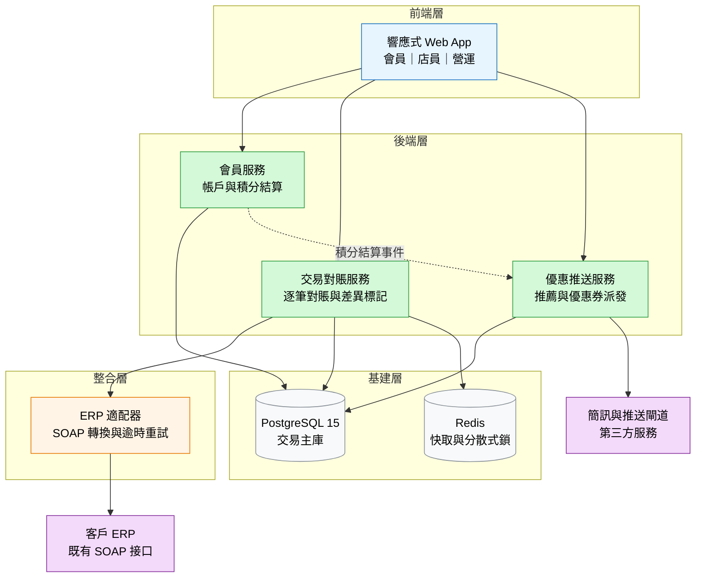
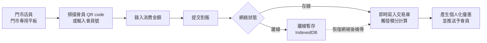
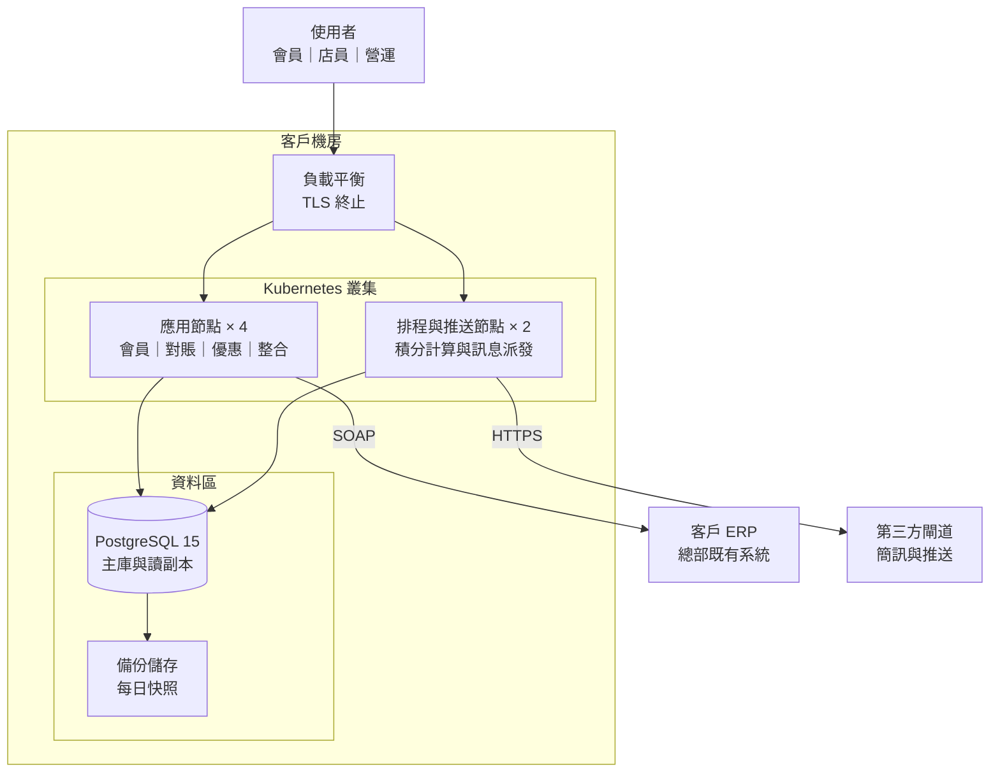
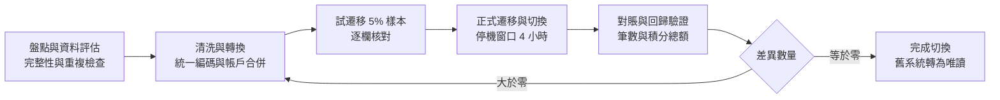

# 實例：Technical Proposal 拆解

> ⚠️ 本檔係**通用化示例**（假設客戶「示例零售集團」、項目「會員 App 改版」），唔係任何真實客戶內容 —— 用嚟示範寫法，唔可以直接交畀客。
> 對應 skill：`dav-technical-proposal`

## 場景

示例零售集團擬將現有會員 App（三年前上線）改版：現有會員 12 萬名、每日活躍約 8 千、月留存率 41%。
改版範圍涵蓋線下門市積分對賬、個人化優惠推送，並整合總部新 ERP；系統全部 on-premise 部署於客戶機房。
客戶方 IT 團隊共 6 人，期望於 4 個月內交付首個版本。

## 1. Project Background（項目背景）

### 1.1 Current Situation Analysis（現況分析）

- 現行會員 App 於三年前上線，功能僅涵蓋會員註冊、積分查詢與優惠券領取，未支援線下門市交易。
- 門市交易以紙本單據與每日人工輸入 App 完成，每日約 1,200 張單據需由兩名全職職員處理，處理時間約 2.5 小時。
- 會員月留存率為 41%，低於同業參考水平 55%；App 崩潰率 0.8%，其中七成來自舊版推薦引擎於尖峰時段耗盡記憶體。

### 1.2 Construction Object（建設目標）

- 建立統一會員交易平台，涵蓋線上交易與門市交易，並於 4 個月內交付首個可用版本。
- 成功指標：門市單據自動對賬覆蓋率 ≥95%；月留存率提升至 55%（上線後第 3 個月量度）；App 崩潰率降至 0.2% 以下。

### 1.3 Project Scope（項目範圍）

- 會員與權限管理
- 線下門市積分對賬
- 個人化優惠與推送
- 總部 ERP 系統整合

### 1.4 Assumption（假設）

- **環境與資源**：全部 on-premise 部署，部署於客戶機房；伺服器與網絡由客戶方提供；ERP 整合採用既有 SOAP 接口。
- **範圍與計算基準**：首個版本以 20 萬會員、每日 5 萬宗交易為設計基準。
- **商業與技術假設**：客戶 ERP 團隊於 2026 年 3 月前提供整合接口文件及測試環境；個人化推薦模型採第三方開源方案，不含模型訓練成本。
- **未列明事項**：任何未於本文件列明之功能或服務均不包含於本次交付範圍。

### 1.5 Out of Scope（不包含範圍）

- 會員 App 之 iOS 與 Android 原生版本（本期僅提供響應式 Web App）
- 支付閘道整合與退款流程改版
- 會員積分商戶之間嘅資金清算流程

### 1.6 Glossary（術語與縮寫表）

| 縮寫 | 英文全稱 | 中文名 | 本方案書內嘅具體所指 |
|------|----------|--------|----------------------|
| API | Application Programming Interface | 應用程式介面 | 本方案對外提供 12 個 RESTful 介面（會員 4、交易 5、優惠 3），對內 6 個 gRPC 介面 |
| ERP | Enterprise Resource Planning | 企業資源規劃系統 | 客戶總部既有 ERP，於本方案以 4 個既有 SOAP 介面對接，介面不變更 |
| POS | Point of Sale | 銷售點終端 | 門市收銀系統，每日匯出交易檔至 SFTP 供對賬 |
| SFTP | Secure File Transfer Protocol | 安全檔案傳輸協定 | 門市交易檔與主資料檔嘅傳輸通道 |
| SLA | Service Level Agreement | 服務水平協議 | 本方案交付後之維護響應時限承諾，詳列於維護條款 |
| P95 | 95th Percentile | 第 95 百分位 | 查詢 API 響應時間之量度方式，見 2.3 效能條款 |

## 2. Technical Solution（技術方案）

### 2.1 System Technical Architecture（系統技術架構）

- **分層結構**：
  - 前端層：響應式 Web App，採 React 18 ＋ TypeScript；離線快取採 IndexedDB 以支援門市弱網情境。
  - 後端層：Spring Boot 3 微服務（會員、交易、優惠、積分四個服務）；服務間以 gRPC 通訊，對外以 RESTful API 供前端及第三方呼叫。
  - 整合層：ERP 整合採適配器模式，ERP 端以 SOAP 提供接口，本層負責協議轉換與欄位映射。
  - 基建層：Kubernetes 部署；PostgreSQL 15 為交易主庫；Redis 處理快取與分散式鎖。
- **資料流**：門市 POS 每日匯出交易檔至 SFTP → 整合層解析並對賬 → 交易服務寫入主庫並觸發積分計算 → 優惠服務於交易完成後產生個人化推薦 → 推送服務經第三方簡訊／推送閘道發送。
- **對外接口**：對外 12 個 RESTful 接口（會員 4、交易 5、優惠 3）；對內 6 個 gRPC 接口；對 ERP 4 個 SOAP 接口（既有，不變更）。

- **圖 1 — 系統架構圖**

- 圖例：前端（藍）／後端（綠）／整合（橙）／基建（灰）／外部系統（紫）。

### 2.2 Functional Design Solution（功能設計方案）

#### 2.2.1 User Surface（用戶介面）

- **會員（手機瀏覽器）**：首頁顯示積分與可用優惠；完成個人化優惠瀏覽、優惠券領取、門市交易記錄查閱。
- **門市店員（門市專用平板）**：掃描會員 QR code 或輸入會員號 → 錄入消費金額 → 提交對賬；支援離線暫存與恢復網絡後自動同步。
- **總部營運（桌面網頁）**：檢視對賬差異報表、手動調整異常交易、設定優惠活動與推送排程。

- **圖 2 — 門市對賬操作流程**

#### 2.2.2 Functional Modules（功能模組）

| 模組 | 做咩（職責） | 包含功能 | 對應角色 |
|------|--------------|----------|----------|
| 會員與權限管理 | 管理會員檔案、積分結算、帳戶狀態與角色權限 | 會員註冊／合併／停用、角色權限設定、積分異動紀錄 | 會員、總部營運 |
| 線下門市積分對賬 | 處理門市交易與會員積分對賬 | POS 交易檔解析、逐筆對賬與差異標記、人工調整審批、對賬報表匯出 | 門市店員、總部營運 |
| 個人化優惠與推送 | 產生並派發個人化優惠 | 推薦規則配置、優惠券發放、推送排程與發送結果追蹤 | 總部營運（間接服務會員） |
| 總部 ERP 系統整合 | 同步交易與會員主檔 | SOAP 接口適配、欄位映射、逾時重試與對賬紀錄 | 總部營運 |

#### 2.2.3 Technical Stack and Framework（技術棧與框架）

- **React 18 ＋ TypeScript**：團隊既有前端技能充足，且支援離線快取所需的 Service Worker；限制為大型報表頁面需額外做虛擬滾動優化。
- **Spring Boot 3**：符合客戶既有 Java 技術棧與維運規範；限制為 JVM 記憶體調校需配合容器資源限制設定。
- **PostgreSQL 15**：交易資料具 ACID 要求，且支援分區表以處理每日 5 萬宗交易的增量；限制為單表寫入高峰需靠分區與讀寫分離緩解。
- **Kubernetes**：客戶機房已有容器平台，可支援服務水平擴展與滾動更新；限制為需客戶平台團隊提供叢集維運支援。

### 2.3 Non Functional Requirement（非功能需求）

- **效能**：App 首屏載入 ≤2 秒（4G 網絡、10 萬會員檔案）；對賬批次處理 10 萬筆交易 ≤30 分鐘；查詢 API 響應時間 ≤500 毫秒（P95）。
- **可用性**：核心服務可用性目標 99.5%；門市對賬服務支援降級至離線暫存，恢復網絡後自動補傳。
- **安全**：全站 TLS 1.2 以上；會員個人資料靜態加密；營運端支援 SSO 與操作稽核紀錄。
- **可擴展**：促銷活動期間支援 5 倍日常併發；積分計算服務以水平擴展處理佇列積壓。
- **合規**：會員資料全部存放於客戶機房境內，不跨境傳輸；保留個人資料查閱與刪除紀錄。

### 2.4 Infrastructure Requirement（基礎設施需求）

- **環境類型**：on-premise，部署於客戶機房；開發、測試、正式三套環境。
- **資源規格**：正式環境 6 節點（4 應用 + 2 資料庫），每節點 16 vCPU / 32 GB；儲存 2 TB SSD；需處理每日 12 GB 交易檔匯入。
- **第三方服務**：簡訊閘道與推送閘道各一項，由客戶方簽訂帳戶；授權費用不包含於本項目。
- **提供方**：伺服器、儲存、網絡與容器平台由客戶方提供；部署與調校由服務提供方負責。

- **圖 3 — 基礎設施拓撲圖**

### 2.5 System Function Screenshots（系統功能畫面）

- **門市對賬（平板）**：店員掃描會員 QR code 後錄入消費金額並提交；圖檔：`docs/proposal/assets/pos-reconcile.png`（待原型定稿後更新）。
- **差異報表（桌面網頁）**：營運檢視逐筆對賬結果並處理異常；圖檔：`docs/proposal/assets/reconcile-report.png`（待原型定稿後更新）。

### 2.6 Data Migration（數據遷移）

#### 2.6.1 Data Migration Strategy（遷移策略）

- 一次性全量遷移會員主檔與未結算積分；交易明細唔遷移，改由 ERP 介面按日增量同步（歷史明細可查詢性由 ERP 保留）。

#### 2.6.2 Migration Scope（Migration Scope）

- 會員主檔約 12 萬筆（姓名、聯絡資料、卡號、等級、積分結餘）；不含交易明細、優惠券紀錄、舊版推薦標籤。

#### 2.6.3 Migration Process（遷移流程）

1. 盤點與資料評估：檢查舊系統資料完整性與重複會員。
2. 清洗與轉換：統一編碼、合併重複帳戶、補齊必填欄位。
3. 試遷移與驗證：遷移 5% 樣本並逐欄核對。
4. 正式遷移與切換：於停機窗口執行全量遷移並切換讀取來源。
5. 對賬與回歸驗證：按總筆數與積分結餘總額對賬，差異逐項處理。

- **圖 4 — 數據遷移流程圖**

#### 2.6.4 Migration Risk and Assumption（遷移風險與假設）

- **舊資料品質不均**：部分會員缺聯絡資料或卡號重複；緩解措施為遷移前先試遷移並產出品質報告，由客戶方確認補錄。
- **停機窗口限制**：假設可取得 4 小時維護窗口；超出則改為增量切換，需客戶方安排額外測試時段。

#### 2.6.5 Data Migration Schedule（遷移排期）

- 2026 年 2 月第 3 週：試遷移與品質報告；2026 年 2 月第 4 週：正式遷移與切換（窗口 4 小時）。

## 3. Implementation Plan（實施計劃）

### 3.1 Project Organization Structure（項目組織結構）

- **專案經理**：進度與風險管理、對客溝通；全職。
- **解決方案架構師**：技術架構、技術選型與品質把關；兼職 50%。
- **前端工程師 × 2**：Web App 與報表頁面；全職。
- **後端工程師 × 3**：會員、交易對賬、優惠與整合；全職。
- **測試工程師 × 1**：功能與效能測試、對賬驗證；前期全職、上線前 2 個月全職。

### 3.2 Project Tentative Schedule（暫定排期）

| Phase | 起訖（暫定） | 交付內容 | 前提條件 |
|-------|--------------|----------|----------|
| Phase 1 — 基礎建置與介面定稿 | 第 1-3 週 | 環境建置、介面契約定義、原型定稿 | 客戶提供環境資源 |
| Phase 2 — 核心功能開發 | 第 4-11 週 | 會員、對賬、優惠、ERP 整合並行開發 | Phase 1 介面契約定稿 |
| Phase 3 — 測試與遷移 | 第 12-15 週 | 整合測試、效能測試、數據遷移與切換 | 客戶提供測試資料 |
| Phase 4 — 上線與觀察 | 第 16 週 | 正式環境部署、上線與指標觀察 | 4 小時維護窗口 |

- **整體前提**：排期依賴客戶於 2026 年 3 月前提供 ERP 接口文件與測試環境，以及 4 小時維護窗口；前提不成立時起算日順延。

## 好嘅寫法 vs 壞嘅寫法

- 壞：「採用現代化架構，提升用戶體驗，系統性能優越。」
- 好：「後端採四個 Spring Boot 微服務；查詢 API P95 響應時間 ≤500 毫秒；限制為 JVM 記憶體調校需配合容器資源限制設定。」

- 壞（口語）：「個 App 舊咗好多，會員都唔再用。」
- 好（書面語）：「現行會員 App 僅涵蓋註冊、積分查詢與優惠券領取，未支援線下門市交易；月留存率為 41%，低於同業參考水平 55%。」

## 常見漏（自查時逐項對）

- 1.3 範圍冇同 2.2.2 模組對齊 → 交付時客戶會追問邊個模組做邊幾多
- 2.2.3 只列技術名冇講「點解揀佢 ＋ 限制」 → 技術選型無從評審
- 2.6 冇寫停機窗口前提 → 遷移排期會爆
- 3.2 冇寫前提 → 排期爭議無仲裁依據
- 圖上節點名同正文唔一致（例如圖寫「對賬服務」、正文寫「交易對賬服務」）→ 客戶對唔上邊個模組
- 交付版保留「待確認」段 → 未確認內容直接漏入客戶稿
