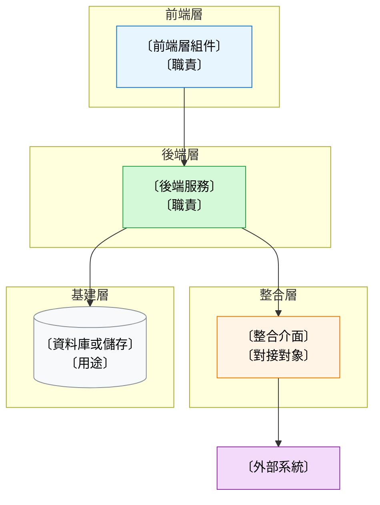
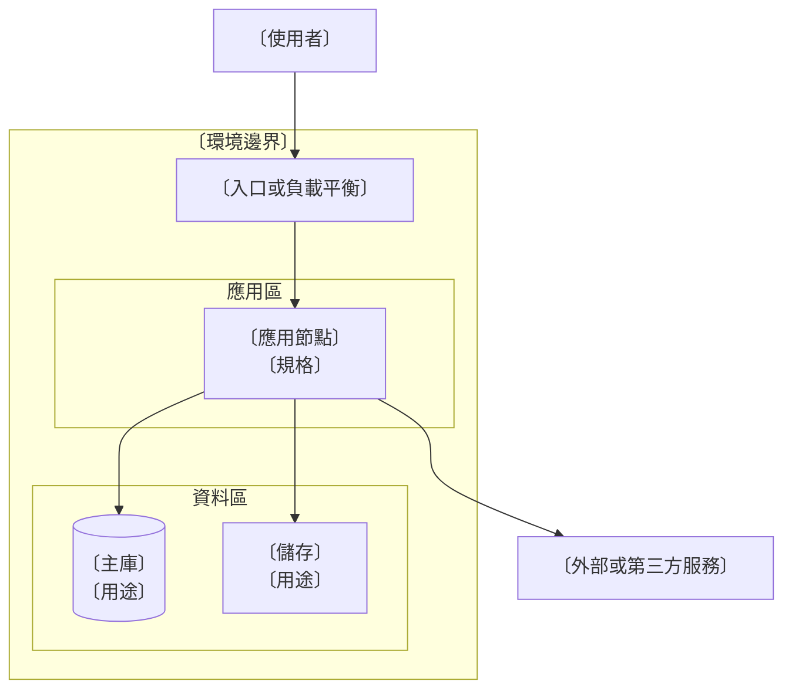

# Dav Technical Proposal — 產出模板

> 本檔只放「可直接填嘅骨架」；規則語意（維度、成熟度、章節寫法、條件式章節）留喺同套 `reference.md`。
> 用法：工作版填齊所有 `<>` 括號位；交付版刪走「待確認清單」段、所有內部註記、所有 `<>` 括號位。
> ⚠️ 括號位寫法已用書面語示例 → 填入內容要保持同一語體（禁用字眼對照 `reference.md` §9）。
> ⚠️ **敘述內容用列表；資料表可以用表格**（術語表、模組對照、環境規格、排期等需要同列比較嘅）→ 規則見 `reference.md` §5 表格使用。
> ⚠️ **Mermaid 內嘅佔位符用「〔…〕」**（唔可以用 `<>`，會被當 HTML 標籤；見 `diagrams.md` §3）。
> ⚠️ 每張圖前加一行 `**圖 N — <圖名>**`；圖檔放 `docs/proposal/assets/<client>-<project>/`。
> ⚠️ **成品要自足**：唔准寫「詳見其他文件／參見附件／如前所述」叫客戶去睇另一份文件，細節直接寫喺正文。
> ⚠️ **1.6 Glossary 交付版必留**：列齊方案書內全部專有名詞縮寫。

## 工作版骨架：docs/proposal/<client>-<project>-<year>-technical-proposal.md

````markdown
# <客戶／項目> Technical Proposal

## 1. Project Background（項目背景）

### 1.1 Current Situation Analysis（現況分析）

- <現況描述：現行做法、系統現狀、流程如何行>
- <瓶頸／痛點：具體到步驟或數量>
- <影響：對業務、客戶或成本嘅影響>

### 1.2 Construction Object（建設目標）

- <目標陳述：建成後系統或流程嘅狀態>
- <成功指標：可驗證、可量度；未確認者標「待確認」>

### 1.3 Project Scope（項目範圍）

- <範圍項目 1（對應 2.2.2 模組）>
- <範圍項目 2>

### 1.4 Assumption（假設）

- **環境與資源**：<部署位置、機器或網絡由邊個提供、第三方服務授權來源>
- **範圍與計算基準**：<數據量級、使用者規模、範圍以邊啲條件為界>
- **商業與技術假設**：<期限前提、既有系統可提供嘅接口或資料、版本與授權年限>
- **未列明事項**：任何未於本文件列明之功能或服務均不包含於本次交付範圍。

### 1.5 Out of Scope（不包含範圍）

- <明確不包含的項目 1>
- <明確不包含的項目 2>
- <明確不包含的項目 3>

### 1.6 Glossary（術語與縮寫表）

| 縮寫 | 英文全稱 | 中文名 | 本方案書內嘅具體所指 |
|------|----------|--------|----------------------|
| <縮寫> | <英文全稱> | <中文名> | <本方案書內嘅具體所指> |

## 2. Technical Solution（技術方案）

### 2.1 System Technical Architecture（系統技術架構）

- **分層結構**：
  - <前端層：職責與技術手段>
  - <後端層：職責與技術手段>
  - <整合層：對接邊啲外部系統、用咩協議>
  - <基建層：容器、儲存、排程等>
- **資料流**：<主要資料由邊度流去邊度、關鍵處理步驟>
- **對外接口**：<接口類型、數量、對象>

- **圖 1 — 系統架構圖**



- 圖例：前端（藍）／後端（綠）／整合（橙）／基建（灰）／外部（紫）

### 2.2 Functional Design Solution（功能設計方案）

#### 2.2.1 User Surface（用戶介面）

- **<使用者類型 1>**：<入口／裝置>；<主要操作路徑>
- **<使用者類型 2>**：<入口／裝置>；<主要操作路徑>

- **圖 2 — 主要操作流程圖**（選做）


#### 2.2.2 Functional Modules（功能模組）

| 模組 | 做咩（職責） | 包含功能 | 對應角色 |
|------|--------------|----------|----------|
| <模組名> | <一句話職責> | <功能 1>、<功能 2> | <角色> |
| <模組名> | <一句話職責> | <功能 1> | <角色> |

#### 2.2.3 Technical Stack and Framework（技術棧與框架）

- **<技術／框架>**：<點解揀佢>；<限制條件或適用邊界>

### 2.3 Non Functional Requirement（非功能需求）

- **效能**：<指標 ＋ 量度方式；未確認標「待確認」>
- **可用性**：<可用性目標、容災或降級安排>
- **安全**：<認證授權、傳輸與儲存加密、稽核要求>
- **可擴展**：<併發或數據量增長時嘅擴展方式>
- **合規**：<數據落地、跨境或行業監管要求>

### 2.4 Infrastructure Requirement（基礎設施需求）

- **環境類型**：<on-premise／cloud／混合>
- **資源規格**：<伺服器、儲存、網絡規格>
- **第三方服務**：<名稱、用途、授權由邊個負責>
- **提供方**：<環境與資源由客戶方抑或服務提供方負責>

- **圖 3 — 基礎設施拓撲圖**



### 2.5 System Function Screenshots（系統功能畫面）

- **<介面名>**：<一句功能說明>；圖檔：<路徑或存放位置>

<!-- 冇原型或畫面時，改用以下寫法（唔准自己生成假圖）：
### 2.5 System Function Screenshots（系統功能畫面）

- **待補截圖清單**
  - <介面名 1>：截圖來源 <來源>；責任方 <角色>；期限 <日期>
  - <介面名 2>：截圖來源 <來源>；責任方 <角色>；期限 <日期>
-->

### 2.6 Data Migration（數據遷移）

<!-- 只喺涉及既有系統或舊數據時出現；唔涉及則整節改寫：
### 2.6 Data Migration（數據遷移）

- 不適用（本次交付不涉及既有數據遷移）。<原因>
-->

#### 2.6.1 Data Migration Strategy（遷移策略）

- <策略：全量／增量／一次性／分批；點解咁揀>

#### 2.6.2 Migration Scope（遷移範圍）

- <遷移嘅資料對象、記錄量級、來源系統>

#### 2.6.3 Migration Process（遷移流程）

1. <步驟 1：盤點與資料評估>
2. <步驟 2：清洗與轉換>
3. <步驟 3：試遷移與驗證>
4. <步驟 4：正式遷移與切換>
5. <步驟 5：對賬與回歸驗證>

- **圖 4 — 遷移流程圖**


#### 2.6.4 Migration Risk and Assumption（遷移風險與假設）

- **<風險>**：<影響>；<緩解措施>
- **假設**：<依賴前提>

#### 2.6.5 Data Migration Schedule（遷移排期）

- <時段：日期或週次>；<所需窗口時長>；<前提條件>

## 3. Implementation Plan（實施計劃）

### 3.1 Project Organization Structure（項目組織結構）

- **<角色>**：<職責>；<投入方式：全職／兼職>；<負責範圍>

### 3.2 Project Tentative Schedule（暫定排期）

| Phase | 起訖（暫定） | 交付內容 | 前提條件 |
|-------|--------------|----------|----------|
| Phase 1 — <名稱> | <週次或日期> | <交付內容> | <前提> |
| Phase 2 — <名稱> | <週次或日期> | <交付內容> | <前提> |

- **整體前提**：<排期依賴嘅前提，例如資料提供、第三方授權取得、客戶測試資源>

## 待確認（內部用，交付版刪走）

- <待確認問題 1> — 負責方：<角色>　期限：<日期>
- <待確認問題 2> — 負責方：<角色>　期限：<日期>
````

## 交付版差異：docs/proposal/<client>-<project>-<year>-technical-proposal-delivery.md

- 同工作版**同一結構、同一章節編號**，只差三樣：
  - 刪走「待確認（內部用，交付版刪走）」整段
  - 刪走所有 `<!-- 內部：… -->` 註記 ＋ 所有 `<>` 括號位
  - 未確認但對客有風險者 → 改寫成 1.4 Assumption 條文（寫法見 `reference.md` §7），唔係直接刪走
- **唔好因為「淨係對客」就剪走** 1.4 Assumption、1.5 Out of Scope、1.6 Glossary —— 前兩段保護自己，Glossary 係客戶讀正文嘅鑰匙
- 交付版仍然要保留章節編號（2.6 若不適用，保留標題 ＋ 「不適用 ＋ 原因」）
